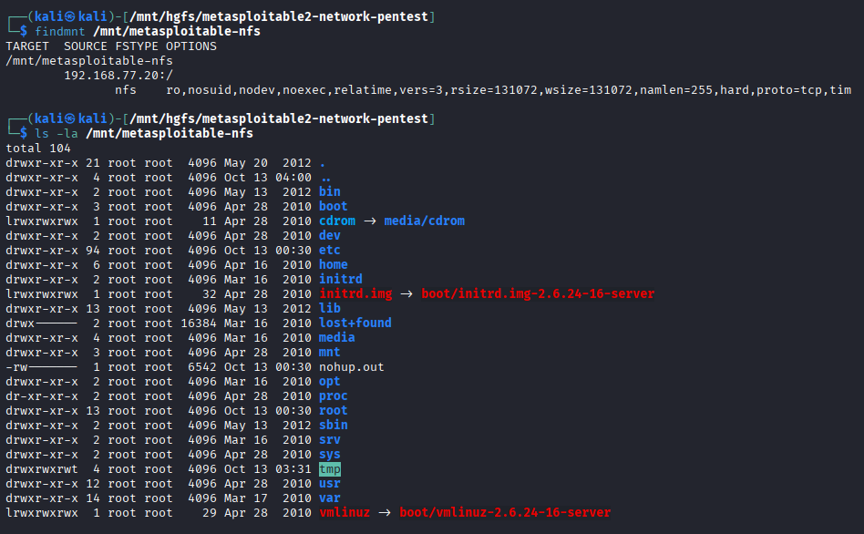

# F06 — NFS Root Export Misconfiguration

**Mức độ:** High
**Target:** `192.168.77.20:2049`  
**Dịch vụ:** NFS  
**CWE:** CWE-552 — Files or Directories Accessible to External Parties  

## 1. Mô tả

NFS được cấu hình chia sẻ thư mục gốc `/` cho các client thông qua export `*`, cho phép máy khác trong mạng truy cập cấu trúc thư mục hệ thống.

## 2. Kiểm chứng (PoC)

**Liệt kê NFS Export:**

```bash
showmount -e 192.168.77.20
```

**Kết quả:**

```text
Export list for 192.168.77.20:
/ *
```

**Mount thư mục chia sẻ:**

```bash
sudo mkdir -p /mnt/metasploitable-nfs

sudo mount -t nfs \
  -o ro,nosuid,nodev,noexec,vers=3 \
  192.168.77.20:/ /mnt/metasploitable-nfs
```

**Kiểm tra quyền truy cập:**

```bash
ls -la /mnt/metasploitable-nfs
```

**Kết quả:** Mount thành công và liệt kê được các thư mục hệ thống như `etc`, `home`, `root`, `usr`, `var`.

Xác nhận thư mục gốc của hệ thống được chia sẻ quá rộng qua NFS. Chưa kiểm chứng khả năng ghi dữ liệu.

**Screenshot:**



**Evidence:** [NFS Root Listing](../evidence/F06-nfs-root-listing.txt)

## 3. Tác động

Có thể làm lộ cấu trúc thư mục và các dữ liệu mà quyền NFS cho phép truy cập, tăng nguy cơ rò rỉ thông tin hệ thống.

## 4. Khắc phục

- Không export toàn bộ thư mục gốc `/`.
- Chỉ chia sẻ các thư mục thực sự cần thiết.
- Giới hạn địa chỉ IP hoặc subnet được phép truy cập.
- Áp dụng quyền truy cập tối thiểu, `root_squash` và cấu hình chỉ đọc khi phù hợp.
- Giới hạn truy cập NFS bằng firewall.